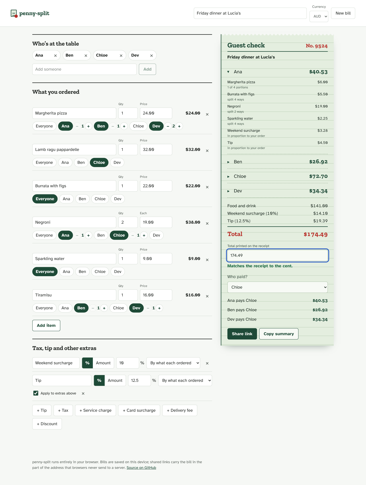
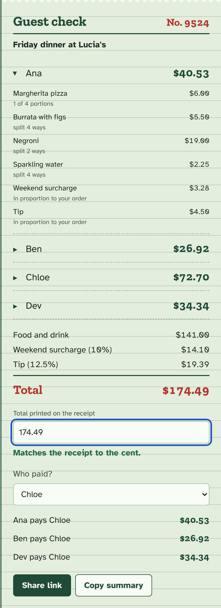
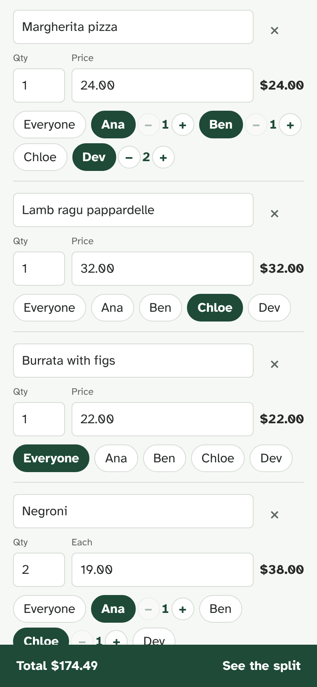
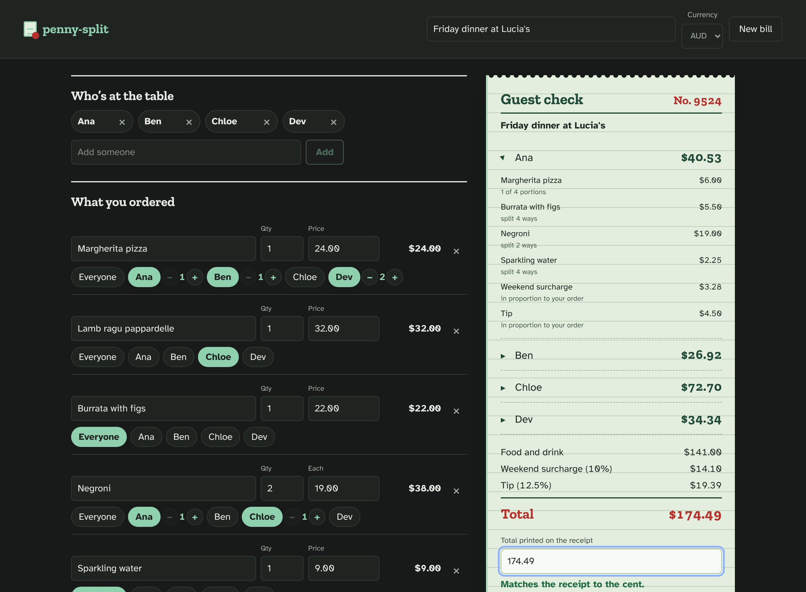

# penny-split

[](https://github.com/iamnarace/penny-split/actions/workflows/ci.yml)

**Split an itemised receipt to the exact cent.** Add who was at the table and what everyone had; shared dishes, uneven portions, tax, tip, surcharges and discounts are divided fairly, and every person's share adds up to the receipt total exactly. No accounts, no server: the bill lives on your device and in the link you share.



## The problem

Splitting a restaurant bill "properly" is fiddly: one person had the steak, three people shared a pizza (one of them had two slices), there's a 10% weekend surcharge and a tip on top. Splitting evenly is unfair; doing it by hand produces totals that are a few cents off the receipt, and someone always ends up covering the difference.

Group-expense apps such as Splitwise and the open-source Spliit are built for running balances across many expenses, and need accounts or a server. Many single-bill splitter apps exist on the app stores, mostly closed-source. penny-split is a small, open-source tool for one job: **one receipt, split item by item, provably to the cent, shareable as a link.**

## Features

- **Item-by-item splitting.** Tap who had each item; untapped items are shared by everyone. Quantities with unit prices.
- **Uneven portions.** "Dev had two of the four slices" splits 2:1:1.
- **Extras done fairly.** Tip, tax, service charge, card surcharge, delivery fee and discounts, as a percentage or an amount, shared in proportion to what each person ordered or evenly. Percentages can apply on top of earlier extras (a tip after a surcharge).
- **Exact to the cent.** All money is integer minor units; shares are allocated with the largest-remainder method using exact integer arithmetic, so the shares always sum to the total. The first person listed absorbs any odd cent, consistently.
- **Receipt check.** Type the printed total and penny-split tells you whether it matches, and if not, how far off and what to look for.
- **Settle up.** Pick who paid to see who owes them what.
- **Share and copy.** A link carries the whole bill; "Copy summary" gives chat-ready text.
- **Careful input.** Amounts accept `12.50`, `$12.50`, `1,234.50`, `12,50` and `1.234,56`; ambiguous or malformed input such as `1.2.3` is rejected with a clear message rather than guessed.
- Undo for removals, ten currencies in the picker (any ISO code works in links), currencies without cents (JPY), light and dark themes, keyboard friendly, works on phones.

| The guest check | Phone | Dark mode |
|---|---|---|
|  |  |  |

## How the maths works

1. Each item's line total (unit price × quantity) is split between the people who had it, by portions.
2. Each extra is computed in whole cents: percentages are rounded half away from zero, using exact integer arithmetic (percent to three decimal places).
3. Each extra is shared by each person's item subtotal ("by what each ordered"), by their running total when it applies on top of earlier extras, or evenly.
4. Every split uses the **largest remainder method**: everyone gets the floor of their exact share, and leftover cents go to the largest remainders (ties to the earlier person). The parts always add up to the whole.

## Tech stack

React 19, TypeScript, Vite; Vitest with Testing Library and jsdom for tests; ESLint; self-hosted fonts (Zilla Slab and Atkinson Hyperlegible, both SIL Open Font License, via Fontsource). Browser tests use Playwright for Python.

## Getting started

Prerequisites: Node.js 20.19 or newer, with npm 11 recommended (Node 24 ships it). npm 10.9 can crash while resolving Vitest's optional peer dependencies.

```bash
git clone https://github.com/iamnarace/penny-split.git
cd penny-split
npm install
npm run dev          # http://localhost:5173
```

Other commands:

```bash
npm test             # Vitest: engine, parsing, links and component tests
npm run typecheck
npm run lint
npm run build        # production build in dist/ (BASE_PATH=/penny-split/ for a sub-path)
npm run preview
python e2e/smoke.py dist   # browser tests: pip install playwright && playwright install chromium
```

## Verification status

Every push runs the full pipeline in GitHub Actions. On the first release (run 39354117949, commit `7d91eb3`):

- 264 installed packages had verified npm registry signatures and 88 had provenance attestations (`npm audit signatures`).
- `npm audit`: 0 vulnerabilities.
- The project type-check and ESLint passed.
- **77 Vitest tests passed**: 66 engine, parsing and link tests, plus 11 component tests with Testing Library.
- The Vite production build succeeded, and **12 browser tests** passed in Chromium against that build.

Development note: in the original development sandbox, a security hook blocked `npm`, so the first round of checks ran locally with preinstalled tools: an esbuild bundle, TypeScript on the engine, and the engine tests on Node's test runner. CI then found and fixed things local checks couldn't reach:

- an npm 10 resolver crash, fixed by using npm 11 in CI;
- missing Vite client types for CSS imports;
- a lint issue: invisible non-breaking spaces in the parser source;
- a real input bug: a new price field showed "0.00", so typing appended to it.

## Dependencies and supply chain

- Runtime dependencies: `react`, `react-dom` and two Fontsource font packages.
- CI installs with `--ignore-scripts`, then runs `npm audit signatures` (registry signatures and provenance attestations) and `npm audit --audit-level=high` before any tool runs.
- A complete `package-lock.json` is not committed yet, because one couldn't be generated where `npm` was blocked. CI uploads the lockfile it resolved as a build artifact; committing a reviewed lockfile is the next step (see Roadmap).

## Project structure

```
src/lib/allocate.ts   exact largest-remainder allocation and percentages (BigInt)
src/lib/money.ts      parsing and formatting amounts, currencies
src/lib/bill.ts       the bill model and computeSplit / settleUp
src/lib/share.ts      versioned, validated share-link format
src/lib/summary.ts    plain-text summary
src/state.ts          reducer for every edit
src/components/       people, items, extras, the guest check, toasts
src/App.tsx           wiring, persistence, sharing, undo
e2e/smoke.py          browser tests against a build
```

## Privacy and security

- No server, no accounts, no analytics, no third-party requests (fonts are bundled).
- The bill is saved in your browser's local storage. Share links carry it in the URL fragment (`#b=…`), which browsers don't send to servers, but anyone with the link can read the bill.
- Shared links are validated field by field (types, ranges, currency codes, unique people) before use, and invalid ones are rejected with a message. Names are rendered as text.

## Known limitations

- One receipt at a time; no running balances between bills.
- Splits by portions use whole numbers (1–99 portions per person).
- No receipt scanning: you type the items.
- Very large bills may produce links too long to share; penny-split warns and suggests copying the summary instead.
- No hosted demo yet.

## Roadmap

- Commit a reviewed lockfile and enable Dependabot.
- Optional hosting on GitHub Pages.
- Item notes, and splitting a single item by amount (not only portions).
- Optional settlement suggestions when several people paid.

## Contributing

See [CONTRIBUTING.md](CONTRIBUTING.md); security reports via [SECURITY.md](SECURITY.md). Research notes are in [docs/RESEARCH.md](docs/RESEARCH.md).

## Licence

Code: [MIT](LICENSE) © 2026 Naresh Adhikari. Fonts: Zilla Slab and Atkinson Hyperlegible are licensed under the SIL Open Font License 1.1 and are distributed via the Fontsource packages.

Developed with assistance from Claude.
